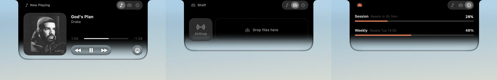

# Notch Dock

Turns the MacBook notch into a small dock. While music plays you get the album art next to the camera, while Claude Code is working you get the mascot and your usage, and hovering opens a panel with a player, a file shelf and a usage gauge.

## Features

- Now playing for Apple Music, with scrubbing, transport controls and AirPlay. The glass picks up the album colour.
- A shelf for parking files: drag them onto the notch, drag them back out later, or drop them on AirDrop.
- Claude Code status and usage (session and weekly limits).
- Short alerts for charging, low battery and AirPods.

## Install

Needs a Mac with a notch on macOS 26 or later.

1. Grab `Notch-Dock.zip` from the [latest release](../../releases/latest) and move the app to Applications.
2. It isn't notarized yet, so right-click it and choose Open the first time.
3. Allow Music access when asked.

## License

Free to use, not open source. See [LICENSE](LICENSE).
